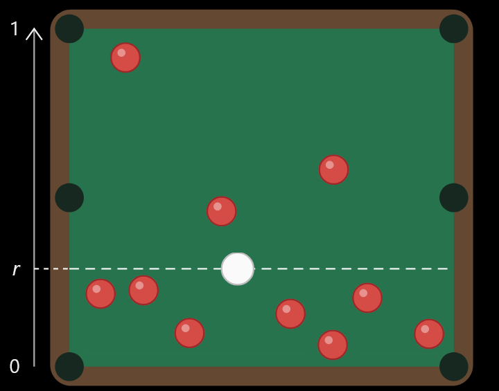
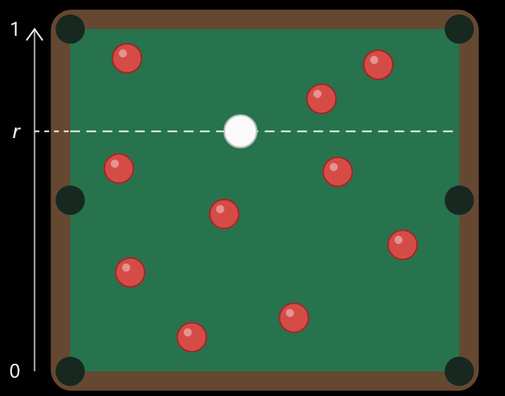
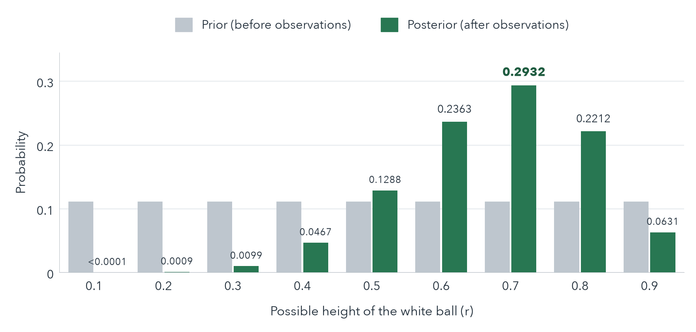

# Understanding Bayes' Theorem – The Pool table experiment

## 1. The central idea: learning from evidence

Imagine a white ball placed somewhere on a pool table. Its exact vertical position is unknown to us.

We want to estimate where it is, but we cannot directly observe it. Instead, we throw several red balls onto the table and observe where they land relative to the white ball:

- A red ball lands below the white ball.
- A red ball lands above the white ball.

The important observation is that **the proportion of red balls landing below the white ball gives us information about its position.**

For example, if most red balls land below it, the white ball is probably located relatively high on the table.

This is the intuition behind Bayesian inference: using observations to improve our knowledge about something we don't know.

## 2. Starting with an initial belief: the prior

Before throwing any red balls, we have no information about the white ball's position.

We therefore start with an initial assumption: all possible positions are equally likely.

Let's call the unknown position of the white ball $R$.

We can represent the possible positions (for the sake of simplicity, we use a discretized space for the position of the white ball) as:

$$
\begin{equation}
R\in\{r_1,r_2,\ldots,r_m\}, r_j \in[0,1]
\end{equation}
$$

where each $r_j$ represents a possible height, with the total height of the pool table set to 1.

If all positions are equally likely, the probability of the white ball being at any particular position is:

$$
\begin{equation}
P(R=r_j)=\frac{1}{m}
\end{equation}
$$

For example, if we consider 10 possible positions, each initially has a probability of $0.1$.

This initial probability distribution is called the **prior**.

It represents what we believe before taking new observations into account.

## 3. Observations provide evidence: the likelihood

We now throw red balls and observe their positions.

For simplicity, let's assign a value to each observation:

- $X_i=1$: the  i-th red ball lands below the white ball.
- $X_i=0$: the i-th red ball lands above the white ball.

Suppose the white ball is at height $r$.

The probability of a red ball landing below it is:

$$
\begin{equation}
P(X_i=1\mid R=r)=r
\end{equation}
$$

And the probability of landing above it is:

$$
\begin{equation}
P(X_i=0\mid R=r)=1-r
\end{equation}
$$

This makes intuitive sense: the higher the white ball is, the more likely a randomly placed red ball is to land below it.

Now imagine throwing $n$ red balls.

If $k$ of them land below the white ball, the remaining $n-k$ land above it.

Assuming the throws are independent, the probability of observing this particular sequence is:

$$
\begin{equation}
P(B\mid R=r)=\prod_{i=1}^{n}P(X_i=x_i\mid R=r)=r^k(1-r)^{n-k}
\end{equation}
$$

Here:
- $B = \bigcap_{i=1}^{n}(X_i=x_i)$ with $x_i \in\{0,1\}$ represents the observations we made.
- $r$ represents a possible position of the white ball.
- $k$ is the number of red balls below it.
- $n-k$ is the number of red balls above it.

This probability is called the **likelihood**.

It tells us how compatible our observations are with each possible position of the white ball.

A higher likelihood means that a particular position provides a better explanation for what we observed.

## 4. Updating our beliefs: Bayes' theorem

We now have two important pieces of information:

1. Our initial belief about the white ball's position (the prior).
2. How well each possible position explains our observations (the likelihood).

Bayes' theorem combines these two elements to produce an updated probability distribution, called the **posterior**.

The general equation is:

$$
\begin{equation}
P(A\mid B)=\frac{P(B\mid A)P(A)}{P(B)}
\end{equation}
$$

In our experiment, we can translate it into:

$$
\begin{equation}
P(R=r\mid B)=
\frac{P(B\mid R=r)P(R=r)}{P(B)}
\end{equation}
$$

Let's interpret the different components:

- $P(R=r\mid B)$: the posterior - probability that the white ball is at position \(r\), given our observations.
- $P(B\mid R=r)$: the likelihood - probability of obtaining our observations if the white ball is at position $r$.
- $P(R=r)$: the prior - initial probability of that position.
- $P(B)$: the evidence - overall probability of obtaining our observations, considering all possible positions.

The evidence is particularly important because it normalizes the result: it ensures that the probabilities of all possible positions add up to 1.

In our experiment, it is calculated by considering every possible position using the law of total probability and equation $(5)$ for the likelihood:

$$
\begin{equation}
P(B)=\sum_{j=1}^{m}P(B\mid R=r_j)P(R=r_j)=\frac{1}{m}\sum_{j=1}^{m}r_j^k(1-r_j)^{n-k}
\end{equation}
$$

The final result is therefore:

$$
\begin{equation}
P(R=r_j\mid B)=
\frac{r_j^k(1-r_j)^{n-k}}
{\displaystyle\sum_{l=1}^{m}r_l^k(1-r_l)^{n-k}}
\end{equation}
$$

This equation gives us the updated probability of the white ball occupying each possible position.

## 5. A numerical example

Let's consider a simple experiment. Suppose the white ball can be located at one of nine possible heights:

$$
R\in\{0.1,0.2,0.3,0.4,0.5,0.6,0.7,0.8,0.9\}
$$

Before throwing any red balls, we assume that all nine positions are equally likely. Therefore, the prior probability of each position is:

$$
P(R=r_j)=\frac{1}{9}\approx 0.111
$$

Now we throw $n=10$ red balls and observe:

- $k=7$ red balls land below the white ball.
- $n-k=3$ red balls land above it.

### Comparing possible positions

The likelihood of any possible position $r$ becomes:

$$
P(B\mid R=r)=r^7(1-r)^3
$$

Let's compare two of our nine possible positions:

**Position A: $(r=0.3)$**

  

$$
P(B\mid R=0.3)=0.3^7\cdot0.7^3=0.0000750141
$$

**Position B: $(r=0.7)$**

  

$$
P(B\mid R=0.7)=0.7^7\cdot0.3^3=0.0022235661
$$

The second likelihood is about 29.64 times higher than the first.

This means that observing seven red balls below and three above is much more compatible with the white ball being at height 0.7 than at height 0.3.

However, likelihood alone does not give us the final probability. We must also consider the prior and normalize across all possible positions.

After doing this, we obtain the posterior distribution:

  

The most probable position is now $r=0.7$. However, this does not mean that we know exactly where the white ball is. Other positions are still possible. **We have simply used our observations to improve our initial belief about the position of the white ball.**

## 6. The process is iterative

One particularly interesting aspect of Bayesian inference is that the process can be repeated.

Imagine throwing another ten red balls after the first ten.

We can now use our previous posterior as our new prior, incorporate the additional observations, and calculate an updated posterior.

Conceptually:

$$
\text{Prior}_1
\xrightarrow{\text{New evidence}}
\text{Posterior}_1
\xrightarrow{\text{More evidence}}
\text{Posterior}_2
$$

As more evidence becomes available, our understanding of the white ball's position generally becomes more precise (looking at the second direction of the pool table for example - left/right)

We are progressively reducing our uncertainty about something we cannot directly observe.

## 7. The bigger picture

The pool table experiment illustrates a much broader principle.

Bayes' theorem is about **how to reason under uncertainty and how to update our beliefs when new information becomes available.**

The essential takeaway is:

**We start with what we believe, observe what happens, evaluate how well our observations fit our assumptions, and update what we believe accordingly.**

That is the fundamental idea behind Bayes' theorem.